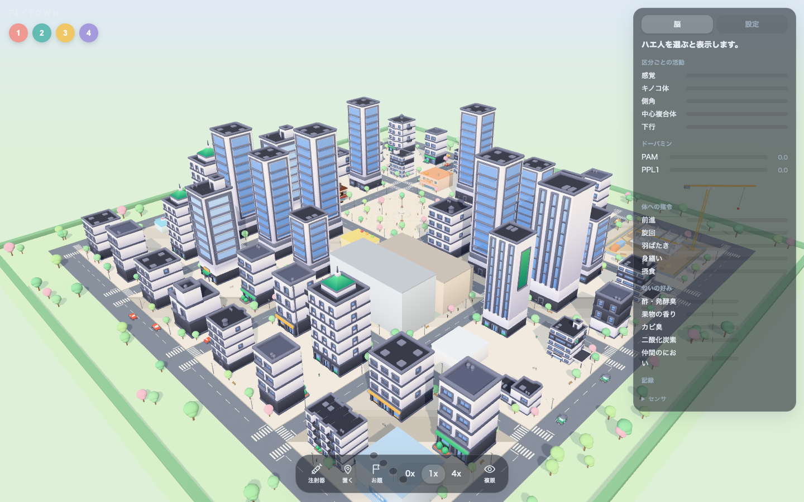

# FLYTOWN

[日本語](#日本語) | [English](#english)



---

## 日本語

### これは何か

頭がハエの人（ハエ人）が街を歩くブラウザゲームです。プレイヤーは直接操作しません。街に匂い・熱・風・障害物を置き、ハエ人にドーパミンを注射して、ハエの脳が何を感じ、何を覚えるかを眺めます。

ハエ人の動きは、FlyWire コネクトームから取り出した神経回路（18,681 ニューロン）に感覚入力を流し、下行ニューロン（DN）の出力を体の命令に写した結果だけで決まります。「障害物があれば曲がる」のような台本は入れていません。壁の衝突や車に当たったときの転倒は物理として別に扱っています。

### 遊び方

- 開くと街の俯瞰が出ます。左上の番号か、街の中のハエ人をクリックすると選べます。最初に選ぶとカメラが追従します。Esc で解除、V で複眼視点です。
- 下のツールバー:
  - 注射器: ハエ人を選び、ご褒美（PAM）・お仕置き（PPL1）・全部と、量 1〜3 を選んで打ちます。打った時点で嗅いでいた匂いが好きまたは嫌いとして残ります。
  - 置く: ゴミ、バナナ、ケーキ、コーヒー、ヒーター、氷、送風機、加湿器、カビ箱、殺虫器、ハエ取り紙、コーンを道に置く・消します。風向と風速も変えられます。
  - お題: 自由、パン屋へ、殺虫器、車道を渡る。それぞれ 1 つの数字で採点します（下記）。
  - 時間: 一時停止、等倍、4 倍。
- 右のパネル: 脳（区分ごとの活動、ドーパミン、体への指令、注射で変わった好み、記録）と設定（言語、影、解像度ほか）。「注射で変わった好み」は、起動直後（暖機後、注射の前）のそのハエ人自身の値を 0 として、匂いごとの変化を -1〜+1 で示します。起動直後はすべて 0 です。匂いの絶対的な好き嫌いは示しません（MBON の価値の向きの割り当てが未検証のため）。生の探り値は、折りたたみのセンサ欄だけにあります。
- 設定の言語で日本語と English を切り替えられます。

#### お題

| お題 | 内容 | 得点（小さいほど良い） |
|---|---|---|
| パン屋へ | 3 分以内にハエ人をパン屋の戸口へ入れる | 時間(秒) x (注射回数 + 1) |
| 殺虫器 | 3 分間、殺虫器に触れさせない。置き物・風・ドーパミンで誘導する | 感電の回数（0 が最良）。同数なら殺虫器の近くにいた時間が短い方 |
| 車道を渡る | 中央の道路を渡り切る | 時間(秒) x (事故回数 + 1) |

最高記録はブラウザの localStorage に残ります。

### 脳のしくみ

- 回路: FlyWire v783（FAFB）から、感覚ニューロン、キノコ体、側角、中心複合体、下行ニューロン、運動ニューロンとそれらをつなぐ中間ニューロンを選んだ部分集合。18,681 ニューロン、404,518 結線。配布は `circuit.bin`（3.3 MB）と `meta.json`。
- 計算: 発火率モデル。1 ステップ 20 ms（50 Hz）、2 サブステップ。符号は伝達物質から決め（ACh・DA・5HT・OA は興奮、GABA・Glu は抑制）、細胞クラスごとの時定数を持ちます。ブラウザの Web Worker で動き、Python 実装と最大誤差 約 2e-11 で一致します（`npm run verify:parity`）。
- 入力: 視葉は含めていません。街で計算した量を、視覚投射ニューロン（LPLC2・LC4・LPLC1・LC16）、嗅覚・味覚・温度・湿度・機械感覚の感覚ニューロン、単眼、頭部の剛毛に直接入れます。左右は細胞の側で分けます。
- 出力: DN の発火率を読み出し（DNp09 前進、DNa01 / DNa02 旋回、MDN 後退、DNp01 と DNg02 羽ばたき、DNg11 / DNg12 身繕い、口吻の運動ニューロン 摂食）、自発活動で z 化して固定の線形式で体の命令にします。係数はゲーム中も較正後も変えません。
- 学習: キノコ体の KC から MBON への結線に、ドーパミン依存の 3 要素則があります。ハエ人ごとに別の重みを持ちます。注射は PAM または PPL1 に電流を入れます。
- 詳細: `docs/MODEL.md`。

### 限界

「本物のハエの脳をそのまま動かしている」わけではありません。

- 視葉（約 7.7 万ニューロン）を省略しています。視覚は、レイで計算した距離・接近速度・明るさを視覚投射ニューロンに入れる近似です。
- 発火率モデルです。スパイクは計算していません。
- 細胞タイプ単位のゲイン（較正）と、感覚チャネル・出力群ごとの感度の調整を使っています。配線そのものは変えていませんが、行動を合わせにいった面があります。
- DN から体の命令への写像は固定の線形式で、設計値です。MN9 と口吻運動ニューロンの対応、MBON の接近・忌避の割り当ては文献で確認していません。
- 体は人型の見立てです。ハエの 6 本脚の歩容と人の歩行は別物です。
- 回路への入力の強さ・街の発生源の強さは見立てで、実測値ではありません。

#### 刺激応答表と行動計測の結果（2026-10-30 時点）

- 刺激応答表（Python、12 項目）: 調整後 5 / 12 一致（調整前 2 / 12）。一致したのは酢への接近、暑さの回避、接近（LPLC2・LC4）での羽ばたき、頭部剛毛での身繕い。基準は 12 項目中 9 一致で、基準に届いていません。一致しなかった項目は `docs/reports/m1_response_table.md` に載せています。再現できなかった反応は、ジオスミン・CO2・寒さの回避、糖での前進低下、苦味による摂食の抑制、風での前進低下、障害物への反応です（項目 2・3・4・5・7・10・12。表の合否が正）。
- 行動計測（ゲームの場と実際の回路、20 シード）: 迫る車への羽ばたき（逃避）は 90%（車なしの対照 35%）で、これだけが基準を満たしました。バナナへの接近 15%（対照 15%）、ジオスミンの回避 15%（対照 15%）、ヒーターの回避は範囲内の滞在 7.8 秒（対照 6.2 秒）で、匂い・熱への反応は自由歩行の軌跡には現れていません。学習は接近割合の差が 0 点（基準 +20 点）で、好みの値だけが 0.085 から 0.092 へわずかに動きました。詳細は `docs/reports/m5_behavior.md`。
- 脳パネルの「注射で変わった好み」は、注射前の自分の値からの変化だけを表示します。果物の匂いとご褒美を 3 回組み合わせると、果物は +0.053 動きますが、組み合わせていない酢も +0.096 動きます。組み合わせた匂いだけを選んで覚える効果は確認できていません。
- 改善を 2 回試しました。2 回目（DN の静止時の活動を底上げ、P9 を旋回に追加）は 3 / 12 に下がったため採用せず、1 回目の回路を公開しています（`docs/consult/004-readout-redesign.md`）。
- 実装の一致、性能、場の物理の確認は `docs/reports/` の m2〜m5。

### 先行事例との比較

| 名前 | 内容 | 本作との違い |
|---|---|---|
| [webgpu-fly](https://github.com/abgnydn/webgpu-fly)（MIT） | 全脳 13.9 万ニューロンの発火モデル + MANC + flybody をブラウザで。キーで DN を刺激してハエを目標まで走らせる | 体はハエ・街なし・神経修飾は対象外・WebGPU 必須・初回 300 MB・実時間より遅い |
| Eon Systems の全脳エミュレーション（2026） | コネクトーム + NeuroMechFly（MuJoCo）。歩く・身繕い・摂食 | 研究デモでゲームではない |
| FlyWire 脳で DOOM / マリオ（2026, 報道） | ゲーム画面を感覚入力に、被弾時に PPL1 へ電流で強化 | ドーパミンは自動の報酬信号で、プレイヤーが打つ道具ではない（記事本文は未読） |
| ChessFly / flyputer | 配線固定でチェス学習 / 小規模スパイキングで叩き避けゲーム | 抽象タスク |
| Crescent Loom / OpenWorm | 自作神経回路で生物を動かす / 線虫の 3D 閲覧 | 実コネクトームの街ゲームではない |

調査は 2026-10-29 時点です。「人型の体、ハエ脳、街の感覚刺激、プレイヤーが打つドーパミン（学習が残る）」の組み合わせは見つかりませんでした。webgpu-fly が最も近い比較対象です。

### ライセンス

- コード: MIT（`LICENSE`）。
- 回路データ `web/public/circuit/`: CC BY-NC 4.0。FlyWire v783 の改変した部分集合です（Zenodo 10.5281/zenodo.10676866）。Zenodo の表記は CC BY 4.0、FlyWire の引用ガイドは公開データを CC BY-NC 4.0 としているため、厳しい方に合わせました。非営利で使ってください。変更点は `web/public/circuit/LICENSE`。
- 3D モデル `web/public/models/`: CC0（Kenney、Quaternius）。`web/public/models/CREDITS.md`。ハエの頭・羽・店・小物・道路はコードで生成しています。

### 引用

回路データを使うときは次を引用してください（詳細は `docs/M0_inputs.md`）。

- Dorkenwald et al. 2024. Neuronal wiring diagram of an adult brain. Nature.
- Schlegel et al. 2024. Whole-brain annotation and multi-connectome cell typing of Drosophila. Nature.
- Matsliah et al. 2024. Neuronal parts list and wiring diagram for a visual system. Nature.
- Berg et al. (2026) Sexual dimorphism in the complete Drosophila male central nervous system connectome. Cell. doi:10.1016/j.cell.2026.08.015
- Tastekin et al. (2026) The complete gustatory connectome of adult Drosophila reveals how taste guides feeding, foraging, and social behavior. Cell. doi:10.1016/j.cell.2026.08.016
- Buhmann et al. 2021. Automatic detection of synaptic partners in a whole-brain Drosophila EM dataset. Nature Methods.
- Eckstein et al. 2024. Neurotransmitter classification from electron microscopy images at synaptic sites in Drosophila melanogaster. Cell.

モデルの根拠にした文献（Shiu 2024、Hige 2015、Aso & Rubin 2016、Rayshubskiy 2024、Bidaye 2020、von Reyn 2014 ほか）は `docs/MODEL.md` と `docs/SPEC.md` にあります。

### 動かす・作り直す

```sh
cd web
npm ci
npm run dev          # http://localhost:5173/flytown/
npm run build        # 型検査 + ビルド（dist/）
```

Node 24 が必要です（`.ts` を直接実行する検査スクリプトのため）。公開は `.github/workflows/pages.yml` が `web/dist` を GitHub Pages に配信します。

検査（すべて固定シード、CLI）:

```sh
npm run check:sim        # 街・場・置き物・殺虫器・ハエ取り紙の物理
npm run verify:parity    # JS と Python の発火率の一致（pipeline/out の台本を使う）
npm run check:behavior   # 匂い・熱・looming・学習の行動計測（20 シード、約 10〜30 分）
npm run check:perf       # fps（ビルド + preview、コンソールを読む）
npm run bench:brain      # 脳 1 ステップの計算時間
```

回路の作り直し（FlyWire の生データは `../flybot/data/flywire/` に必要です。約 1 時間）:

```sh
# 公開している回路（round 1）を保存済みパラメータから作り直す（数秒。sha256 先頭 dc58423c3a0f と一致を確認）
../flybot/.venv/bin/python -m pipeline.extract --variant r1
../flybot/.venv/bin/python -m pipeline.export --variant r1
# 較正・調整からすべて作り直す（約 1 時間。この経路の再実行は未確認）
../flybot/.venv/bin/python -m pipeline.build --variant r1
```

結果は `web/public/circuit/` と `docs/reports/` に書かれます。仕様は `docs/SPEC.md`、段階は `docs/ROADMAP.md`、検証の記録は `docs/VERIFICATION_LOG.md` です。

---

## English

### What it is

A browser game where fly-headed people (fly-persons) walk around a town. You do not steer them. You place odors, heat, wind and obstacles, inject dopamine, and watch what the fly brain senses and remembers.

Each fly-person is driven only by a neural circuit extracted from the FlyWire connectome (18,681 neurons): sensory input is injected into the circuit, and descending neuron (DN) outputs are mapped to body commands. There is no behavior script such as "turn if there is an obstacle". Collisions and falling after a car hit are plain physics, separate from the brain.

### How to play

- The game opens with a bird's-eye view. Click a number at the top left, or a fly-person in the town, to select it. The first selection makes the camera follow. Esc releases it; V toggles the compound-eye view.
- Toolbar:
  - Syringe: select a fly-person, choose Reward (PAM), Punish (PPL1) or All, and a dose 1-3. The odor being smelled at that moment is remembered as liked or disliked.
  - Place: put or remove garbage, banana, cake, coffee, heater, ice, fan, humidifier, mold box, bug zapper, fly paper and cones. Wind direction and speed are adjustable.
  - Mode: Free, To the bakery, Bug zapper, Cross the road. Each is scored by one number (below).
  - Time: pause, 1x, 4x.
- Right panel: Brain (regional activity, dopamine, body commands, preference change from injections, record) and Settings (language, shadows, resolution, etc.). "Preference change from injections" shows, per odor, the change from that fly's own value right after startup (after warm-up, before any injection) on a -1 to +1 scale. Every odor reads 0 at startup. It does not show absolute likes or dislikes, because the MBON valence assignment is unverified. The raw probe values appear only in the collapsed sensor section.
- Switch between Japanese and English in Settings.

#### Modes

| Mode | Goal | Score (lower is better) |
|---|---|---|
| To the bakery | Get the fly-person to the bakery door within 3 minutes | time (s) x (injections + 1) |
| Bug zapper | Keep it from touching the zapper for 3 minutes, using items, wind and dopamine | number of zaps (0 is best); ties broken by less time near the zapper |
| Cross the road | Get across the central road | time (s) x (accidents + 1) |

Best scores are stored in the browser's localStorage.

### How the brain works

- Circuit: a subset of FlyWire v783 (FAFB): sensory neurons, mushroom body, lateral horn, central complex, descending and motor neurons, and the intermediate neurons that connect them. 18,681 neurons, 404,518 connections. Shipped as `circuit.bin` (3.3 MB) and `meta.json`.
- Computation: a firing-rate model, 20 ms per step (50 Hz), 2 substeps. Signs follow the predicted neurotransmitter (ACh, DA, 5HT, OA excitatory; GABA, Glu inhibitory), with a time constant per cell class. It runs in a Web Worker and matches the Python implementation to a maximum error of 約 2e-11 (`npm run verify:parity`).
- Input: the optic lobe is not included. Quantities computed in the town are injected directly into visual projection neurons (LPLC2, LC4, LPLC1, LC16), sensory neurons for smell, taste, temperature, humidity and wind, ocelli, and head bristles. Left and right are split by each cell's side.
- Output: DN firing rates are read out (DNp09 forward, DNa01 / DNa02 turning, MDN backward, DNp01 and DNg02 wing flap, DNg11 / DNg12 grooming, proboscis motor neurons feeding), z-scored against spontaneous activity and mapped to body commands by fixed linear formulas. The coefficients are not changed during play or after calibration.
- Learning: KC to MBON connections in the mushroom body have a dopamine-dependent three-factor rule, with separate weights per fly-person. An injection drives PAM or PPL1 with a current.
- Details: `docs/MODEL.md`.

### Limitations

This is not "a real fly brain running as is".

- The optic lobe (about 77,000 neurons) is omitted. Vision is an approximation: ray-cast distance, approach speed and brightness are fed to visual projection neurons.
- It is a rate model; no spikes.
- Cell-type gains (calibration) and per-channel and per-output sensitivities were adjusted. The wiring itself is unchanged, but the adjustment was made toward target behaviors.
- The DN-to-body mapping is a fixed linear formula with design-chosen coefficients. The match between MN9 and the proboscis motor neurons, and the approach/avoid assignment of MBONs, are not checked against the literature.
- The body is a human-shaped analogy. A fly's six-legged gait and human walking are different things.
- Input strengths and the strengths of town sources are design choices, not measurements.

#### Response table and behavior measurement (as of 2026-10-30)

- Stimulus-response table (Python, 12 items): 5 of 12 matched after tuning (2 of 12 before): vinegar approach, heat avoidance, looming-driven wing flap (LPLC2, LC4), and grooming on head-bristle input. The gate is 9 of 12; it was not met. Items that did not match are listed in `docs/reports/m1_response_table.md` (that table is authoritative).
- Behavior measurement (game field plus the real circuit, 20 seeds): escape by wing flap to an approaching car was 90% (35% in the no-car control), the only item that met its criterion. Approach to banana was 15% (control 15%), avoidance of geosmin 15% (control 15%), and time in the heater zone 7.8 s (control 6.2 s): odor and heat responses do not show in free-walking trajectories. Learning changed the approach fraction by 0 points (criterion +20); only the preference value moved slightly, from 0.085 to 0.092. Details in `docs/reports/m5_behavior.md`.
- The brain panel's "Preference change from injections" shows only the change from the fly's own pre-injection value. After 3 pairings of fruit odor with reward, fruit moves +0.053, but unpaired vinegar moves +0.096. Odor-specific learning is not confirmed.
- Two improvement rounds were tried. Round 2 (raising DN resting activity, adding P9 to steering) dropped to 3 of 12, so it was rejected and the round 1 circuit is published (`docs/consult/004-readout-redesign.md`).
- Implementation parity, performance and field physics are in `docs/reports/` (m2 to m5).

### Prior art

| Name | What it is | Difference |
|---|---|---|
| [webgpu-fly](https://github.com/abgnydn/webgpu-fly) (MIT) | 139k-neuron whole-brain spiking model + MANC + flybody in the browser; DNs are stimulated by keys to run the fly to a target | Fly body, no town, neuromodulation explicitly out of scope, WebGPU required, 300 MB first load, slower than real time |
| Eon Systems whole-brain emulation (2026) | Connectome + NeuroMechFly (MuJoCo): walking, grooming, feeding | A research demo, not a game |
| DOOM / Mario on a FlyWire brain (2026, press) | Game screen as sensory input, PPL1 stimulation on hits | Dopamine is an automatic reward signal, not a tool the player uses (article body not read) |
| ChessFly / flyputer | Fixed-wiring chess learning / small spiking net swatting game | Abstract tasks |
| Crescent Loom / OpenWorm | Custom circuits driving creatures / 3D viewer of a worm | Not a town game on a real connectome |

Surveyed on 2026-10-29. We found no project combining a human-shaped body, a fly brain, town sensory stimuli, and player-injected dopamine with lasting learning. webgpu-fly is the closest comparison.

### License

- Code: MIT (`LICENSE`).
- Circuit data `web/public/circuit/`: CC BY-NC 4.0, a modified subset of FlyWire v783 (Zenodo 10.5281/zenodo.10676866). Zenodo says CC BY 4.0 while the FlyWire citation guidelines say CC BY-NC 4.0 for public data, so the stricter one is used. Non-commercial use only. Changes are listed in `web/public/circuit/LICENSE`.
- 3D models `web/public/models/`: CC0 (Kenney, Quaternius); see `web/public/models/CREDITS.md`. The fly head, wings, shops, props and roads are generated in code.

### Citations

If you use the circuit data, please cite (details in `docs/M0_inputs.md`):

- Dorkenwald et al. 2024. Neuronal wiring diagram of an adult brain. Nature.
- Schlegel et al. 2024. Whole-brain annotation and multi-connectome cell typing of Drosophila. Nature.
- Matsliah et al. 2024. Neuronal parts list and wiring diagram for a visual system. Nature.
- Berg et al. (2026) Cell. doi:10.1016/j.cell.2026.08.015
- Tastekin et al. (2026) Cell. doi:10.1016/j.cell.2026.08.016
- Buhmann et al. 2021. Automatic detection of synaptic partners in a whole-brain Drosophila EM dataset. Nature Methods.
- Eckstein et al. 2024. Neurotransmitter classification from electron microscopy images at synaptic sites in Drosophila melanogaster. Cell.

The literature behind the model choices (Shiu 2024, Hige 2015, Aso & Rubin 2016, Rayshubskiy 2024, Bidaye 2020, von Reyn 2014, etc.) is listed in `docs/MODEL.md` and `docs/SPEC.md`.

### Run and rebuild

```sh
cd web
npm ci
npm run dev          # http://localhost:5173/flytown/
npm run build        # type check + build (dist/)
```

Node 24 is required (check scripts run `.ts` directly). `.github/workflows/pages.yml` deploys `web/dist` to GitHub Pages.

Checks (fixed seeds, CLI):

```sh
npm run check:sim        # town, field, items, zapper and fly paper physics
npm run verify:parity    # JS vs Python firing-rate match (uses the script in pipeline/out)
npm run check:behavior   # odor, heat, looming and learning measurements (20 seeds, about 10-30 min)
npm run check:perf       # fps (build + preview, read the console)
npm run bench:brain      # brain step time
```

Rebuilding the circuit (needs the FlyWire raw data at `../flybot/data/flywire/`; about 1 hour):

```sh
# Regenerate the published circuit (round 1) from saved params (seconds; checks sha256 prefix dc58423c3a0f)
../flybot/.venv/bin/python -m pipeline.extract --variant r1
../flybot/.venv/bin/python -m pipeline.export --variant r1
# Full rebuild including calibration and tuning (about 1 hour; this path has not been re-run)
../flybot/.venv/bin/python -m pipeline.build --variant r1
```

Output goes to `web/public/circuit/` and `docs/reports/`. Spec: `docs/SPEC.md`; stages: `docs/ROADMAP.md`; verification log: `docs/VERIFICATION_LOG.md`.
